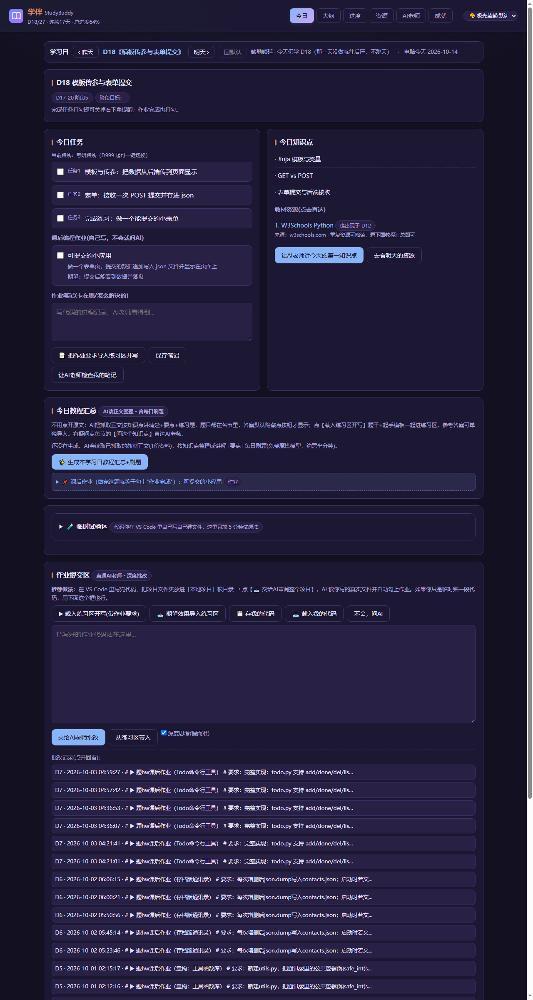
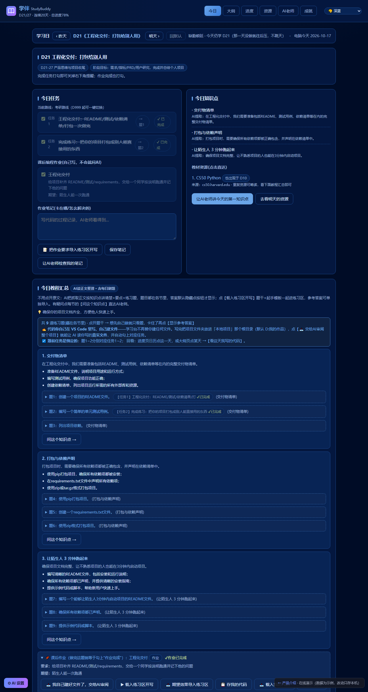
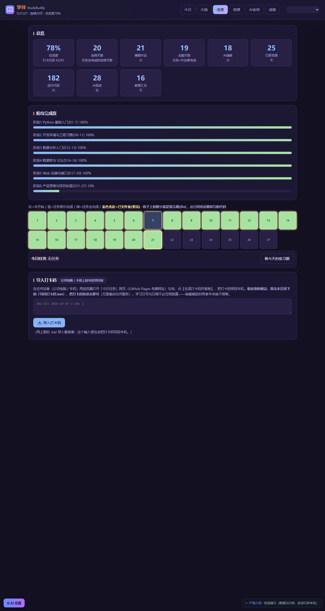
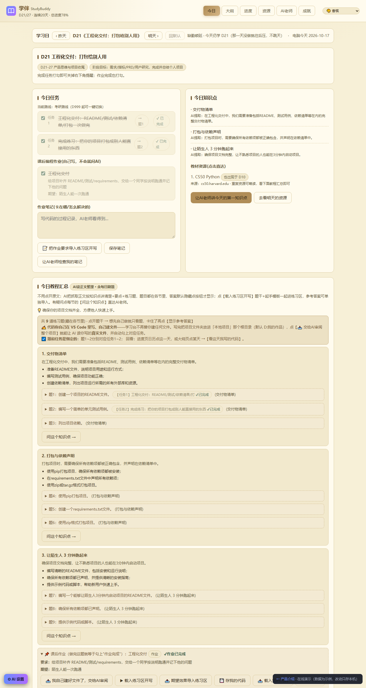

# 学伴 StudyBuddy

[](https://github.com/chenzhongyu331166-hub/study-buddy/stargazers)
[](https://github.com/chenzhongyu331166-hub/study-buddy/network/members)
[](https://github.com/chenzhongyu331166-hub/study-buddy/releases)
[](./LICENSE)
[](https://www.python.org/)
[](https://flask.palletsprojects.com/)

**给「想自学一门技术却没人带」的人做的本地 AI 学习台**：每日任务打卡 + AI 老师批改作业 + 自动抓教材做教程汇总 + 终端式真机代码练习区——全部本地运行、免费 AI 额度，不花一分钱订阅。

A self-hosted AI study dashboard: daily checklists, AI tutoring & homework grading, auto-fetched course materials, and a real-Python code playground — runs 100% locally.

> 学习计划（学科、天数、每日任务）由 `plan.json` 定义，可自由替换成你自己的计划。
> 本仓库自带一份「CS 速成」示例计划，课程大纲见 [课程大纲.md](./课程大纲.md)。

## 核心功能

- **自适应学习计划**：把一门技术拆成每天若干小任务（任务 + 知识点 + 教材链接 + 1 个编程作业），计划天数可长可短
- **代码练习区（终端式真机运行）**：跑本机真 Python，traceback 原样显示；支持运行中继续喂输入、`input()` 提示灰显、报错附中文白话贴士
- **今日教程汇总（含每日刷题）**：AI 读当天抓取的教材正文，按知识点分节讲解 + 要点 + 练习题；参考答案默认隐藏，可一键导入练习区
- **作业提交区**：贴码直通 AI 老师深度批改（完成度/问题/改法/得分），记录存档可回看
- **进度与成就**：计划日历（交过作业的日期带金色光边）、阶段完成度、成就墙
- **本地项目 AI 审阅**：把整个作业文件夹交给 AI，按「需求对照/结构/问题清单/亮点/下一步」输出
- **每日提醒**：右下角弹窗没打完勾关不掉；单实例 + 当天只自动弹一次
- **9 套皮肤**：右上角下拉即切（记忆偏好）

## 界面截图

| 默认(极光蓝紫) | 深蓝 |
|---|---|
|  |  |

| 进度(交作业=金色光边) | 香槟(浅色) |
|---|---|
|  |  |

## 架构

```
                        ┌──────────────────────────────┐
        浏览器           │  static/index.html（单页前端）  │
   （电脑 / 手机）  ───►  │  今日 · 大纲 · 进度 · 资源      │
                        │  AI老师 · 成就 · 9套皮肤        │
                        └──────────────┬───────────────┘
                            HTTP /api/* │ (JSON)
                        ┌──────────────▼───────────────┐
   桌面提醒 popup.py ──►│   Flask 服务  app.py :5000     │
   （Tk 常驻弹窗）      └──────────────┬───────────────┘
                                       │
        ┌───────────────┬─────────────┼─────────────┬────────────────┐
        ▼               ▼             ▼             ▼                ▼
   计划层          状态层         AI 层         执行层          资源层
 plan.json      data/state.json   调大模型     真机 Python     抓教材正文
 任务/知识点/    打卡/进度/连续    教程汇总/    在 data/run     存 resources/
 资源/作业       天数/成就         批改/答疑/   运行学生代码    供次日汇总
                                  项目审阅
```

- **前端**：`static/index.html` 单页 + 原生 JS，CSS 全量变量化以支持多主题
- **后端**：Python 3.11 + Flask，本地 HTTP 服务
- **AI**：调用 OpenAI 兼容接口（默认魔搭）完成教程汇总 / 作业批改 / 答疑 / 项目审阅
- **数据**：`data/` 下本地 JSON 存储，进度与隐私不出本机

## 仓库结构

| 文件 | 作用 |
|---|---|
| `plan.json` | 学习计划数据：任务 / 知识点 / 资源(带来源) / 作业 |
| `build_plan.py` | 生成 `plan.json`（示例：CS 速成计划） |
| `app.py` | Flask 学习台服务（打卡/进度/成就/AI老师/资源抓取/交互运行/批改/汇总） |
| `popup.py` | 右下角常驻提醒：没打完勾关不掉，全完成变绿 |
| `static/index.html` | 学习台页面（今日/大纲/进度/资源/AI老师/成就） |
| `export_outline.py` | 导出 [课程大纲.md](./课程大纲.md) |
| `pages/` `docs/` | 生成并发布静态体验页（GitHub Pages） |

## 快速开始（部署到你自己的电脑）

```bat
:: 1) 克隆
git clone https://github.com/chenzhongyu331166-hub/study-buddy.git
cd study-buddy

:: 2) 建虚拟环境并装依赖
python -m venv venv
venv\Scripts\pip install -r requirements.txt

:: 3) 启动（自动打开 http://127.0.0.1:5000）
start.bat
```

> `start.bat` 使用脚本自身所在目录，不写死路径；放在哪都能跑。

## 接入 AI（可选）

AI 相关功能（教程汇总 / 批改 / 答疑 / 项目审阅）需要一份模型通道配置（`base_url` + `api_key` + `model`）。

- 当前版本默认读取本机 `~/.config/opencode/opencode.jsonc` 的 provider 段；
- 也可用 `data/ai_config.json` 单独指定学习台使用的通道，例如：
  ```json
  { "provider": "modelscope", "model": "Qwen/Qwen3.5-397B-A17B" }
  ```

> 未配置 AI 时，**打卡 / 大纲 / 进度 / 代码练习区** 仍可正常使用，仅 AI 汇总、批改、答疑等不可用。
> 首次运行向导（填自己的 key）列为产品化待办，见下。

## 学习流程

1. 打开学习台看今日任务 / 知识点 / 教材链接，自己写作业
2. 在练习区真机运行调试；卡住了去「AI老师」提问
3. 交作业给 AI 批改；完成逐个打勾，进度入日历、连续天数 +1
4. 收尾点「今天学完」→ 系统自动抓取明天教材，生成明日教程汇总

## 做成你自己的计划（迁移）

学习台与「学什么」是解耦的，换计划只需改 `plan.json`：

- **换学科 / 换时长**：改 `build_plan.py` 或直接编辑 `plan.json`（结构见上方「架构」）；天数、阶段、每天任务都能改。
- **AI 通道**：按「接入 AI」一节配好即可。
- **数据**：`data/`、`resources/` 不入库，属于你自己的进度，不会随仓库分发。

**产品化待办**（当前版本尚未做的部分，欢迎一起补）：
1. 首次运行向导：图形界面选学科 / 填天数 / 填自己的 AI key，自动生成 `plan.json`
2. 打包：免安装的 exe / 一键启动器，让不装 Python 的人也能用
3. 多用户与云端同步（可选）

## 开源与第三方来源

- 开源库：Flask、requests、pystray、Pillow（均按其开源许可使用）
- AI 服务：OpenAI 兼容接口（示例默认使用 ModelScope 魔搭社区免费额度）
- 教材资料：仅链接 / 抓取官方与知名公开教程章节用于学习，来源随资源记录标注，不搬运、不商用
- 本项目以 [MIT](./LICENSE) 协议开源

## License

[MIT](./LICENSE)
